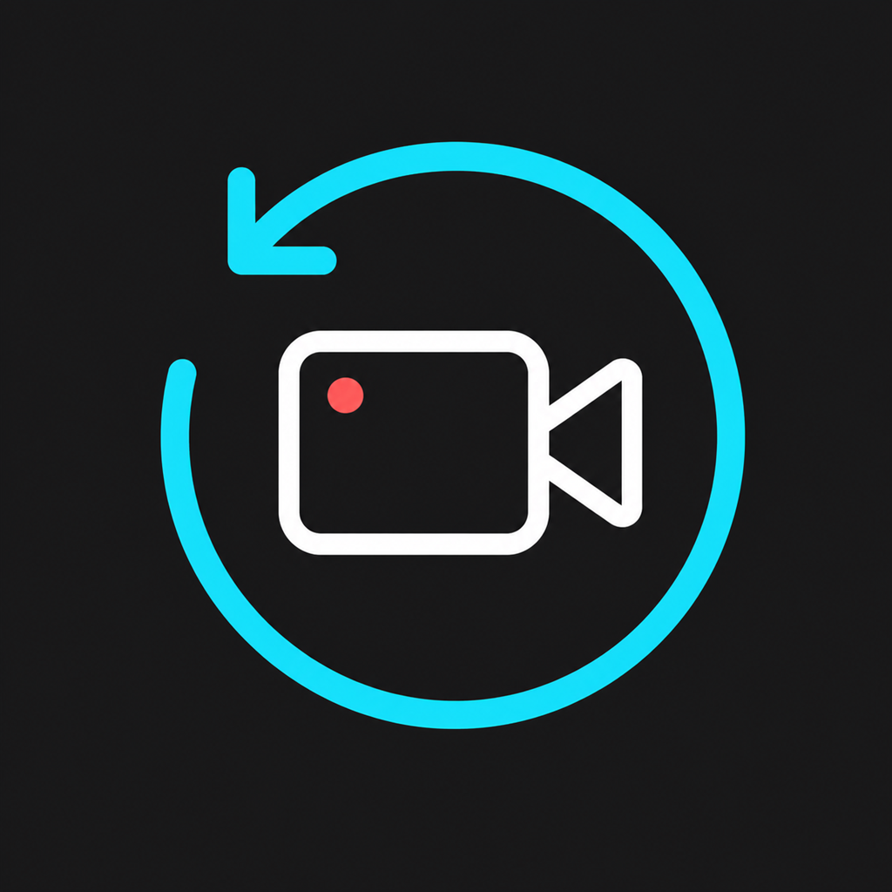
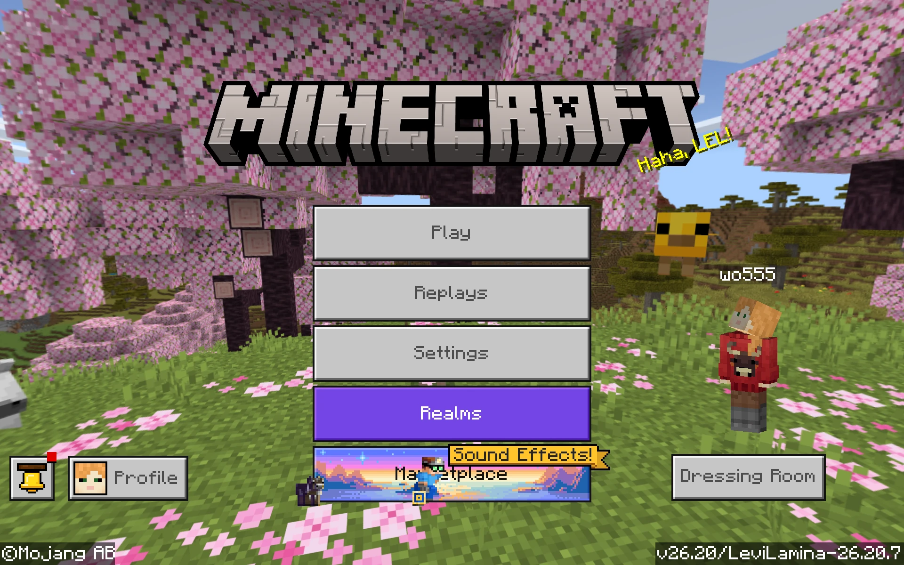
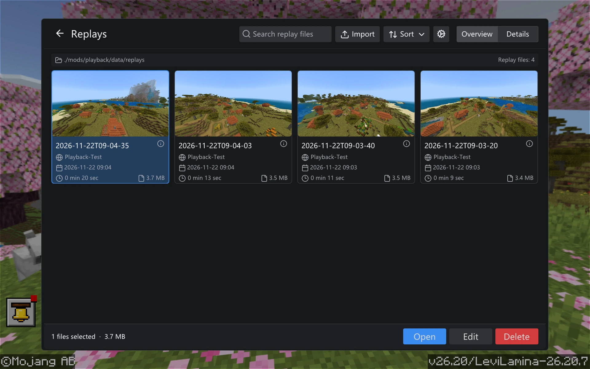
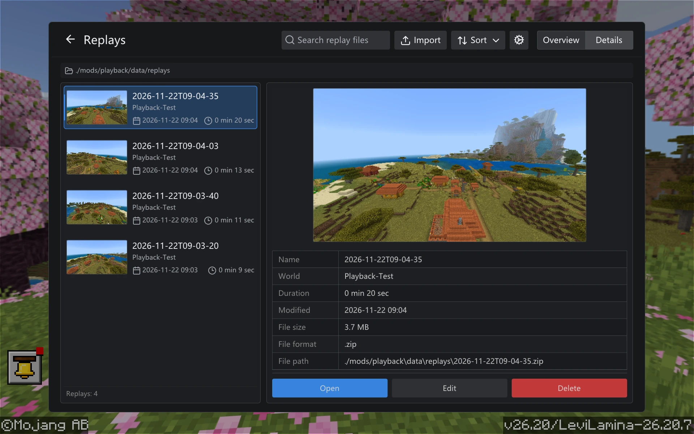
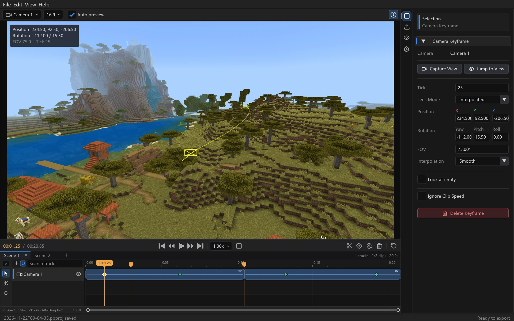

  
  <h1>Playback</h1>
  
<strong>Record, revisit, and replay Minecraft Bedrock.</strong>

  
An open-source Minecraft Bedrock replay recorder and cinematic camera editor for LeviLamina on Windows, with experimental video export.

  

    
    
    
    
  

  

    
    
    
    
    
  

  

    <a href="docs/getting-started.md">Get started</a>
    ·
    <a href="https://github.com/wo55555/Playback/releases">Releases</a>
    ·
    <a href="CHANGELOG.md">Changelog</a>
    ·
    <a href="https://github.com/wo55555/Playback/issues">Report an issue</a>
    ·
    <a href="CONTRIBUTING.md">Contributing</a>
    ·
    <a href="#code-of-conduct">Code of Conduct</a>
    ·
    <a href="README_ZH.md">简体中文</a>
  

  

    
    
  

> [!WARNING]
> Playback is still in an early stage of development. All currently published releases are prereleases. Keep backups of important worlds and recordings; replay compatibility is not guaranteed across Minecraft, LeviLamina, or Playback version changes.

Playback records client-visible Minecraft Bedrock sessions into portable replay archives, opens them in an isolated local replay world, and provides timeline-based cinematic camera keyframes. Experimental MP4 and PNG-sequence export is available for testing.

## Quick Start

> [!IMPORTANT]
> Use a clean LeviLamina client instance when possible. Broad compatibility with other mods is not currently guaranteed.

1. Create or select a clean LeviLamina client instance for the target Minecraft version.
2. Install the matching Playback `#client` release through LeviLauncher/Lip or from the release ZIP.
3. Launch the game, record with `record start` / `record pause` / `record stop`, then open the exported replay from the main-menu **Playback** browser.

See the [installation and usage guide](docs/getting-started.md) for screenshots, exact Lip commands, manual installation, recording, and replay instructions.

## Showcase

  <strong>Main menu integration</strong> 
  

  <strong>Native replay browser</strong> 
  

  <strong>Replay preview and file details</strong> 
  

  <strong>In-game timeline editor</strong> 
  

> [!NOTE]
> The UI is still under active development, and the current interface does not represent the final design.

## Minecraft Bedrock Replay and Camera Features

- **Session capture** — Records loaded chunks, block actors, entity movement, player state, time, and selected client-safe game packets.
- **Multiplayer chunk compatibility** — Preserves local-world chunk handling while capturing portable replay data after client decoding on servers that use alternate chunk transport modes.
- **Low-impact recording** — Writes replay snapshots and timeline data asynchronously to reduce recording stalls.
- **Portable archives** — Exports recordings as replay files that are easy to store and share.
- **Isolated playback** — Opens recordings from a native main-menu browser in a dedicated local replay world.
- **Replay browser** — Searches, imports, filters, sorts, renames, deletes, and opens replay files, with grid and list views.
- **Replay thumbnails** — Captures a preview image during recording when the game is in a menu-free state.
- **Timeline controls** — Supports play, pause, seek, speed control, and quick navigation during replay.
- **Timeline editor** — Provides zoomable tracks, resizable panels, camera/sequence/entity-segment editing, and undo/redo, with projects saved next to the replay data and restored on reopen.
- **Server custom blocks and dimensions** — Registers block types recorded from the server and resolves custom dimensions by name, so modded worlds replay with their own geometry, materials, and dimension layout.
- **Cinematic camera keyframes** — Captures position, yaw, pitch, roll, and FOV with Smooth, Linear, Ease, Hold, Hermite, and Cubic Bezier interpolation.
- **Dimension-aware camera paths** — Splits camera tracks at every dimension change so preview and export never interpolate through unrelated worlds.
- **First-person follow** — Views the replay through the recorder, another player, or any entity, with the recorded HUD, held maps, view bobbing, and portal and sleep effects.
- **Preview controls** — Choose visible HUD elements and adjust preview volume, mute, and silence while paused without changing exported audio. Recorded containers and server forms are previewed when following the recorder in first person.
- **Experimental video export** — Renders a selected tick range to H.264 MP4 with AAC, Opus, or FLAC audio, or to PNG sequences with a sidecar WAV. Audio is optional, in mono or stereo, with configurable frame rate, resolution, SSAA, warm-up frames, and extra renders per frame.
- **D3D11 and D3D12 capture** — Supports the native renderer on both backends; D3D12 supports 1x/2x/4x SSAA and D3D11 uses 1x.
- **Bilingual UI** — Localizes commands, the native replay UI, and the resource-pack main-menu button in English and Simplified Chinese.

## Latest Changes

`v0.4.0` brings the same feature set to MC 26.10, MC 26.20, MC 26.40, MC 26.51, and MC 26.60. First- and third-person camera tracks select the recorder or another player; entities can also be followed from the viewport. Recordings retain the HUD, held maps, view effects, server resource packs, and client-generated sounds, with optional local-view sampling up to 120 Hz. The timeline adds multi-select, snapping, markers, and context menus, while the pause menu gains recording controls, a save dialog, and a recording indicator.

The inspector's Preview page controls the HUD and preview audio independently of export audio. The tabbed export dialog adds audio codecs, channel and bitrate choices, and silent exports. Export timing follows replay time, including lighting effects and interface animations; dimension changes preserve the recorded seed and biomes and repeat renderer warm-up. Recording snapshots and seeking are faster, and closing a replay cleans up its temporary world, including during export. See the limitations below before using experimental renderer paths.

> [!CAUTION]
> Playback releases are still prereleases and may make incompatible format or configuration changes. Replays recorded before `v0.4.0` are not supported and must be recorded again; older archives may not be detected as incompatible. The camera switch track was removed, and its data in earlier editor projects is dropped. Back up existing recordings and projects before upgrading; no migration is provided.

> [!IMPORTANT]
> The **Playback** main-menu button still uses a lightweight UI resource pack. Complete Lip and release-ZIP installations include it under `mods/playback/resource_packs/playback-ui/`; the Release also provides `playback-ui.mcpack` for standalone manual import.

See the full [changelog](CHANGELOG.md) for release history and detailed changes.

## Compatibility

Playback maintains five separate `0.4.0` prerelease lines. Install only the release that matches your Minecraft and LeviLamina runtime; the release suffix is not always the game version.

| Minecraft / LeviLamina | Playback release                                                                    | Status     |
| ---------------------- | ----------------------------------------------------------------------------------- | ---------- |
| `26.10.*`              | [`v0.4.0-mc26.10`](https://github.com/wo55555/Playback/releases/tag/v0.4.0-mc26.10) | Prerelease |
| `26.20.*`              | [`v0.4.0-mc26.20`](https://github.com/wo55555/Playback/releases/tag/v0.4.0-mc26.20) | Prerelease |
| `26.40.*`              | [`v0.4.0-mc26.40`](https://github.com/wo55555/Playback/releases/tag/v0.4.0-mc26.40) | Prerelease |
| `26.51.*`              | [`v0.4.0-mc26.50`](https://github.com/wo55555/Playback/releases/tag/v0.4.0-mc26.50) | Prerelease |
| `26.60.*`              | [`v0.4.0-mc26.60`](https://github.com/wo55555/Playback/releases/tag/v0.4.0-mc26.60) | Prerelease |

All release lines target Minecraft Bedrock for Windows x64 and are distributed as client-only mods. The `mc26.50` line targets Minecraft 26.51. The `mc26.60` build requires exactly Minecraft `1.26.60.5`; other 26.60 game builds are not supported. The 26.40 dependency range is `>=26.40.5 <26.50.0`.

> [!NOTE]
> `0.2.0` was deliberately skipped on MC 26.20. Video export did not work on that runtime: the 26.20 headers mis-declare a struct alignment, so the capture path read a render-item count from padding, classified every submission as overlay-only, and stalled every export on frame 0. The 26.20 line therefore goes from `v0.1.2-mc26.20` straight to `v0.2.1-mc26.20`, which carries the fix. The MC 26.10 line is unaffected and did publish `v0.2.0-mc26.10`.

> [!TIP]
> Playback is a client-only mod that can record sessions in both local worlds and multiplayer servers.

## Build From Source

Playback builds on Windows x64 with Visual Studio 2022, xmake, and Git. See the [source-build guide](docs/building.md) for clean Release commands, output layout, and dependency troubleshooting.

## Commands

| Command                     | Description                                                           |
| --------------------------- | --------------------------------------------------------------------- |
| `playback version`          | Show the loaded Playback version.                                     |
| `record start`              | Start or resume recording the current world.                          |
| `record pause`              | Pause the active recording.                                           |
| `record stop`               | Stop recording and export the replay.                                 |
| `record rate [20-120]`      | Show or set the local player's view samples per second until restart. |
| `record indicator [on/off]` | Toggle, show, or hide the on-screen recording indicator.              |

## Languages

Playback currently includes English (`en_US`) and Simplified Chinese (`zh_CN`) translations stored in `src/lang/`.

## Frequently Asked Questions

### What is Playback?

Playback is a native Minecraft Bedrock replay recorder and camera editor for the Windows x64 LeviLamina client. It stores client-visible session data and reconstructs it in a separate local replay world.

### Can Playback record multiplayer servers?

Yes. Playback is client-only and can record the chunks, entities, and selected packets visible to the client in local worlds or multiplayer sessions. The August 20, 2026 hotfix improves recording for servers that use alternate chunk transport or custom entity registries. Replays recorded before the fix cannot recover data that was never saved and may need to be recorded again.

### Can Playback export a replay to video?

Yes, experimentally. MP4 uses H.264 video and optional AAC, Opus, or FLAC audio; PNG sequences get an optional `.audio.wav`. Audio can be mono or stereo. AAC is the default and the most widely compatible choice; some players do not support Opus or FLAC in MP4. Preview volume and mute do not affect exports.

### Do camera keyframes interpolate across dimensions?

No. Every recorded dimension change splits the camera timeline, including transitions through dimensions that contain no camera keyframes.

### Which Playback build should I install?

Use the matching entry in [Compatibility](#compatibility). In particular, Minecraft 26.51 uses `v0.4.0-mc26.50`, and `v0.4.0-mc26.60` supports only Minecraft `1.26.60.5`. Do not mix release lines.

## Development Status and Roadmap

- The recording, replay, camera, and export workflows remain under active development and optimization.
- Multiplayer server recording and replay will receive further debugging; testing and feedback are welcome.
- Planned work includes broader renderer compatibility and additional camera tooling.

> [!TIP]
> **Testing focus:** Please report reproducible camera, cross-dimension, chunk-loading, and export issues with the replay file, logs, GPU, renderer backend, and export settings.

## Known Limitations

- The replay format is still under development and may change during Alpha releases.
- Playback reconstructs recorded client-visible state; it is not a deterministic copy of the original server simulation.
- Pending scheduled ticks and server-owned systems such as villages, raids, and POI state are not currently persisted as authoritative simulation state.
- Video export is still experimental, and runtime issues may remain.
- Use standard/Fancy graphics for routine recording, replay, and export. Ray tracing and Vibrant Visuals have received targeted export tests and timing fixes, but remain experimental; this is not a guarantee of broad renderer or shader-pack compatibility.
- Regular grid/dither patterns in some exports and occasional native dimension-loading warnings remain under investigation. Report the renderer, export settings, logs, and a short reproducible clip if affected.
- SSAA is limited to 4x on D3D12, lower when the supersampled render size does not fit, and to 1x on D3D11.
- A camera can only render chunks present in the replay data; unrecorded terrain cannot be reconstructed.
- The August 20, 2026 fix cannot retroactively restore server chunk or custom-entity registry data missing from an existing replay archive.
- Compatibility must be checked again after updating Minecraft or LeviLamina.

Please report reproducible problems with logs, versions, and a minimal replay where possible.

[Open an issue](https://github.com/wo55555/Playback/issues) to report a reproducible problem.

## Contributing

See the [source-build guide](docs/building.md) and [CONTRIBUTING.md](CONTRIBUTING.md) for the build, formatting, and pull request workflow.

Please read and follow our [Code of Conduct](CODE_OF_CONDUCT.md). By participating in this project, you agree to abide by its terms.

Report security issues privately by following [SECURITY.md](SECURITY.md). Do not open a public issue for a security vulnerability.

## Code of Conduct

Playback follows the Contributor Covenant Code of Conduct. Please read [CODE_OF_CONDUCT.md](CODE_OF_CONDUCT.md) before participating in issues, pull requests, discussions, or community spaces.

## Acknowledgements

Special thanks to the [LeviLamina](https://github.com/LiteLDev/LeviLamina) maintainers and community for providing the native modding platform and tooling that make Playback possible, and to the [Flashback](https://github.com/Moulberry/Flashback) project and its contributors for the replay concepts and architecture that inspired Playback.

## License

Copyright (C) 2026 [wo555](https://github.com/wo55555)

Playback is released under the [GNU Affero General Public License v3.0](LICENSE). Distributed modifications must remain under AGPL-3.0 and provide their corresponding source code. Third-party components retain their own licenses; see [THIRD_PARTY_NOTICES.md](THIRD_PARTY_NOTICES.md) and the `licenses/` directory.
