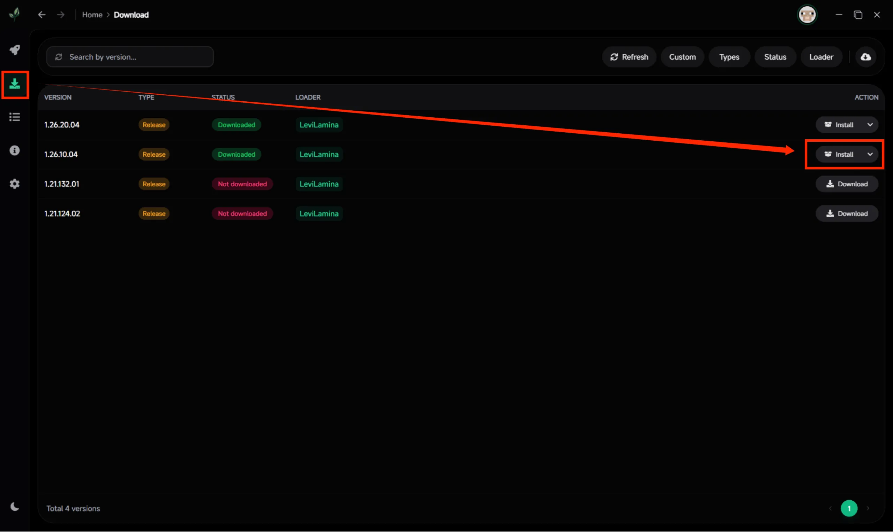
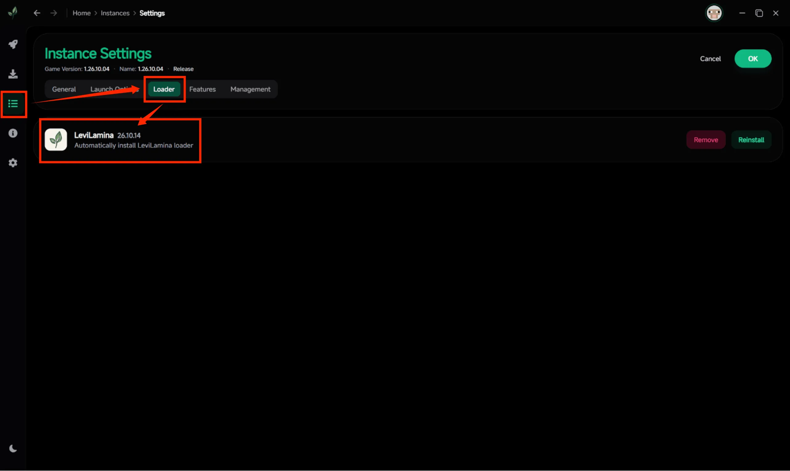
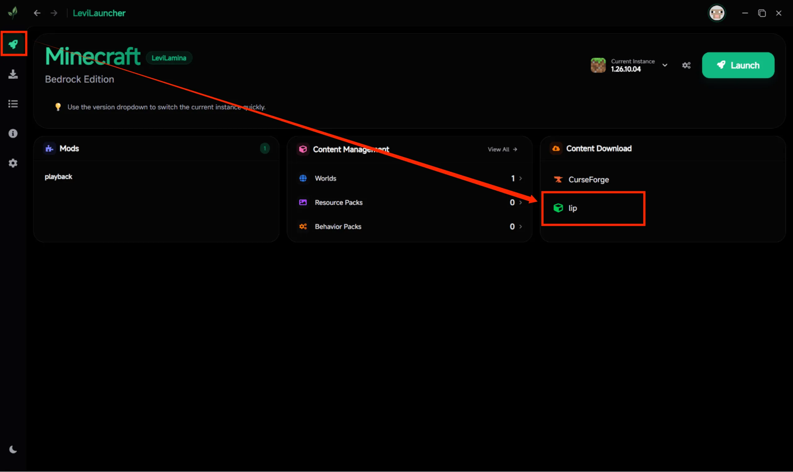
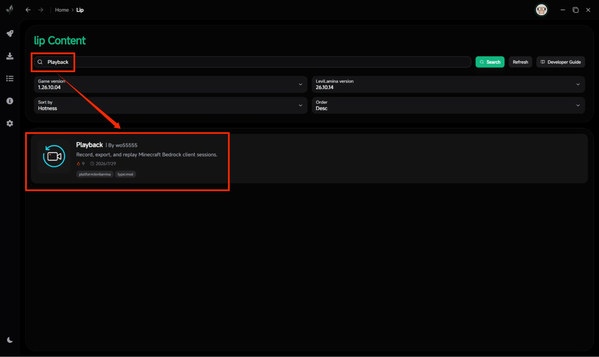
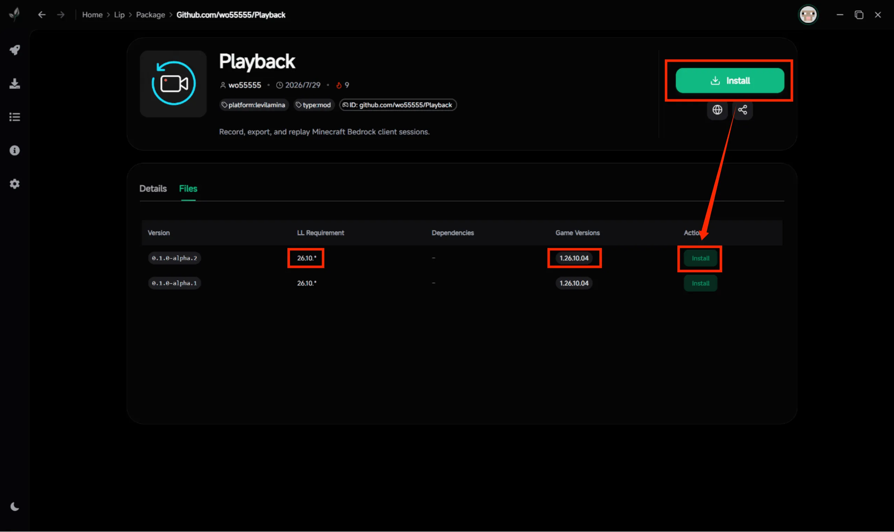

# Playback Installation and Usage

[Back to README](../README.md) | [简体中文](getting-started.zh-CN.md)

## Before Installing

Playback is a client-only LeviLamina mod for Windows x64. Choose the release that matches the Minecraft and LeviLamina version used by your instance.

| Minecraft / LeviLamina | Playback release                                                                    |
| ---------------------- | ----------------------------------------------------------------------------------- |
| `26.10.*`              | [`v0.4.1-mc26.10`](https://github.com/wo55555/Playback/releases/tag/v0.4.1-mc26.10) |
| `26.20.*`              | [`v0.4.1-mc26.20`](https://github.com/wo55555/Playback/releases/tag/v0.4.1-mc26.20) |
| `26.40.*`              | [`v0.4.1-mc26.40`](https://github.com/wo55555/Playback/releases/tag/v0.4.1-mc26.40) |
| `26.51.*`              | [`v0.4.1-mc26.50`](https://github.com/wo55555/Playback/releases/tag/v0.4.1-mc26.50) |
| `26.60.*`              | [`v0.4.1-mc26.60`](https://github.com/wo55555/Playback/releases/tag/v0.4.1-mc26.60) |

All five release lines above are prereleases; install only the version that matches your instance. The `mc26.50` release targets Minecraft 26.51. The `mc26.60` build requires exactly Minecraft `1.26.60.5`. The 26.40 dependency range is `>=26.40.5 <26.50.0`.

> [!IMPORTANT]
> Use a clean LeviLamina instance without other third-party mods whenever possible. Broad mod compatibility is not currently guaranteed.

> [!WARNING]
> Use standard/Fancy graphics for routine use. Ray tracing and Vibrant Visuals have received targeted export tests, but remain experimental. Some exports still show grid/dither patterns, and occasional native dimension-loading warnings remain under investigation.

> [!CAUTION]
> `v0.4.1` is a prerelease on every release line. Replays recorded before `v0.4.0` are not supported and must be recorded again; older archives may not be detected as incompatible. The camera switch track was removed, and its data in earlier editor projects is dropped. Back up recordings and projects before upgrading; no migration is provided.

## Install with LeviLauncher and Lip

The screenshots below use a `26.10` instance and are illustrative. For `26.20`, `26.40`, `26.51`, or `26.60`, follow the same steps with the matching Minecraft, LeviLamina, and Playback release. Screenshots may show an earlier UI layout.

1. Select **Download** in the left sidebar, find the Minecraft version you want, and use its install menu to create an instance with the **LeviLamina** loader.

<p align="center">
  
</p>

2. Select **Instances**, open the new instance's settings, and confirm under **Loader** that the matching LeviLamina version is installed.

<p align="center">
  
</p>

3. Select **Launch** to return to the main page. Choose the target instance, then select **lip** under **Content Download**.

<p align="center">
  
</p>

4. Search for **Playback**, then open the package published by `wo55555`.

<p align="center">
  
</p>

5. Manually choose the release whose **LL Requirement** and **Game Versions** match your instance, then select **Install** in that version's row. Lip does not select a Playback version based on the installed LeviLamina version.

<p align="center">
  
</p>

Launch or restart the game. The bundled button resource pack loads automatically, and the **Playback** button should appear on the Minecraft main menu. The Release also provides `playback-ui.mcpack` for standalone manual import.

## Install with the Lip CLI

Run the matching command from the root directory of the target LeviLamina instance:

```powershell
# Minecraft / LeviLamina 26.10
lip install github.com/wo55555/Playback@0.4.1-mc26.10#client

# Minecraft / LeviLamina 26.20
lip install github.com/wo55555/Playback@0.4.1-mc26.20#client

# Minecraft / LeviLamina 26.40
lip install github.com/wo55555/Playback@0.4.1-mc26.40#client

# Minecraft / LeviLamina 26.51
lip install github.com/wo55555/Playback@0.4.1-mc26.50#client

# Minecraft 1.26.60.5 / LeviLamina 26.60
lip install github.com/wo55555/Playback@0.4.1-mc26.60#client
```

> [!NOTE]
> The `#client` variant is required. Always specify and verify the matching release; Lip does not choose one from the installed LeviLamina version.

## Manual Installation

Download `Playback-client-windows-x64.zip` from the matching release, then extract its `playback` directory into the LeviLamina instance's `mods` directory and restart the client.

## Record

Join a world, open the client command console, and use:

```text
record start
record pause
record stop
```

`record start` begins or resumes recording, `record pause` pauses capture, and `record stop` finishes and exports the replay. The pause menu's icon row offers the same start, pause, finish and cancel controls; finishing from the pause menu asks for a replay name. Exported replay archives are stored under Playback's `data/replays` directory.

`record indicator` toggles the top-right recording indicator, and `record indicator on|off` sets it. `record rate [20-120]` sets how many times per second the local player's view is sampled until the game restarts; the starting value comes from `record.localPlayerUpdatesPerSecond` in the config.

## Replay

1. Return to the main menu and select **Playback**.
2. Choose a `.playback` or compatible `.zip` replay in the browser.
3. Wait for the isolated replay world and initial chunks to load.
4. Use the timeline to play, pause, seek, change speed, or jump to either end. Use **File > Exit Replay** to leave.

## Camera Editing

1. Add or select a camera in the timeline editor.
2. Move the playhead to the desired tick and use **Add Keyframe at Playhead**.
3. Edit position, yaw, pitch, roll, FOV, interpolation, and Cubic Bezier controls in the property inspector.
4. Add more keyframes and play or scrub the replay to preview the interpolated camera. Keyframes also update the preview while paused; hold the left mouse button over the viewport to move the free camera.

Camera interpolation is automatically split at every recorded dimension change. Keyframes in different dimension segments never interpolate through each other, including when an intermediate dimension contains no camera keyframes.

First-person and third-person tracks choose a recorded player between their first and last keyframes; overlapping tracks use the highest track in the list. The viewport's subject picker and context menu can also follow a player or entity. Press F5 to switch a followed player's first-/third-person view, or tap Shift alone to stop following.

## Preview Options

The inspector's **Preview** page selects the visible chat, boss bar, title, scoreboard, action bar, and hotbar; only the hotbar is on by default. These choices also apply to exports unless **Hide HUD** removes the entire HUD there. Recorded containers and server forms are previewed only while following the recorder in first person. Their recorded open/closed state is restored on seeks; switching away closes the preview.

Preview **Mute**, **Volume**, and **Silent while paused** are saved with the editor layout and never change exported audio. **Silent while paused** is on by default and suppresses world sounds triggered while paused or seeking, rather than changing the recording.

## Keyboard Shortcuts

**Help > Keyboard Shortcuts** lists the current bindings in the editor.

| Shortcut                        | Action                          |
| ------------------------------- | ------------------------------- |
| `Space`                         | Play / pause                    |
| `Home` / `End`                  | Jump to start / end             |
| `Left` / `Right`                | Seek 1 second                   |
| `Ctrl+Left` / `Ctrl+Right`      | Seek 1 tick                     |
| `Up` / `Down`                   | Next / previous edit point      |
| `J` / `L`                       | Slower / faster playback        |
| `-` / `=`                       | Zoom timeline out / in          |
| `Alt+Wheel`                     | Zoom timeline around the cursor |
| `\`                             | Zoom timeline to fit            |
| `K`                             | Add a camera keyframe           |
| `Ctrl+Shift+N`                  | Add a camera track              |
| `1` / `2` / `3`                 | Switch to camera 1 / 2 / 3      |
| `I` / `O`                       | Mark the export in / out point  |
| `Delete` / `Backspace`          | Delete the selected item        |
| `Ctrl+Z` / `Ctrl+Y`             | Undo / redo                     |
| `Ctrl+S`                        | Save the project                |
| `Ctrl+E`                        | Open the export settings        |
| `Ctrl+Shift+F`                  | Maximize / restore the viewport |
| `Ctrl+Shift+-` / `Ctrl+Shift+=` | Smaller / larger interface      |
| `Ctrl+Shift+0`                  | Reset the interface scale       |
| `Esc` (hold 0.8 s)              | Exit the replay and save        |

Keyboard input belongs to the editor while it is open. Hold the left mouse button over the game viewport to drive the observer camera; shortcuts pause while it is held.

## Experimental Video Export

Open **File > Export...** in the replay editor. Settings are arranged on four pages. Export buttons stay visible; on short windows the summary hides before the settings page scrolls:

- **General**: output name and folder, MP4 or PNG sequence, frame rate, and start/end ticks. The name is used verbatim; existing files get numbered suffixes. Use the playhead buttons or the timeline's I/O shortcuts to set a short range before testing a long export. Start with 30 FPS.
- **Video**: output resolution, SSAA, warm-up frames, **Hide HUD**, MP4 encode speed, and CRF. Start with 1x SSAA. Warm-up runs again after dimension changes.
- **Audio**: enable or disable game audio, choose mono or stereo, and select AAC (default), Opus, or FLAC for MP4. AAC and Opus offer 128/192/256/320 kbps; FLAC is lossless and has no bitrate setting. PNG sequences use an uncompressed sidecar `.audio.wav` when audio is enabled. Some players cannot play Opus or FLAC in MP4; choose AAC for wider compatibility.
- **Advanced**: extra renders (default 0). Extra renders draw each output frame additional times without saving those passes, helping temporal effects settle at the cost of a full render per pass. Client ticks are accelerated automatically; there is no separate Accelerate client option.

Typed numbers take effect immediately and are clamped to their allowed range. Check the summary before starting. Preview volume and mute are independent of all export audio settings.

The experimental exporter renders frames from replay time rather than recording the screen in real time. MP4 uses the bundled FFmpeg/libx264 tool; PNG export remains available if FFmpeg cannot be started. Outputs are written under `mods/playback/exports` by default.

| Backend  | Formats                 | SSAA        |
| -------- | ----------------------- | ----------- |
| D3D12    | H.264 MP4, PNG sequence | 1x, 2x, 4x  |
| D3D11    | H.264 MP4, PNG sequence | 1x          |

> [!IMPORTANT]
> Video export is experimental on every backend; the table describes capture capabilities, not a stability guarantee. Prefer standard/Fancy graphics and test a short clip first. Camera regions must exist in the recording: unrecorded terrain cannot be reconstructed. Cross-dimension loading, replay-state preparation, UI stabilization, and renderer warm-up use timeouts, and missing replay data can still prevent the intended scene from rendering. Keep logs if an export shows grid/dither patterns or loading warnings.

For development instructions, see [Building Playback](building.md). Release history is available in the [changelog](../CHANGELOG.md).
