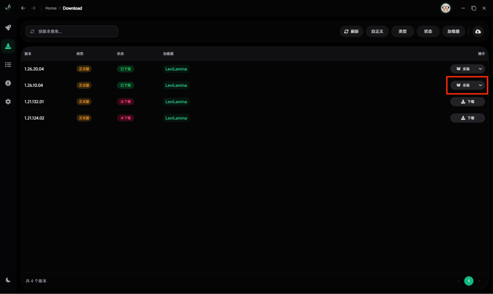
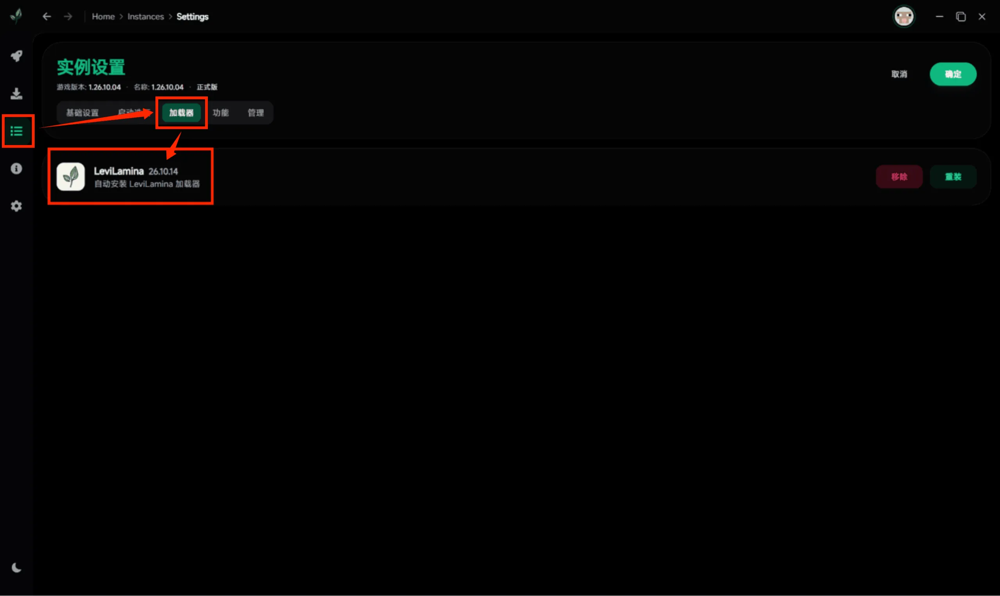
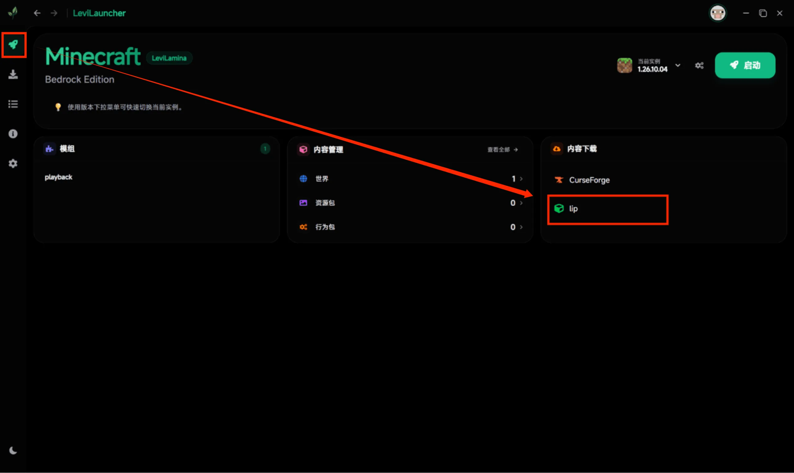
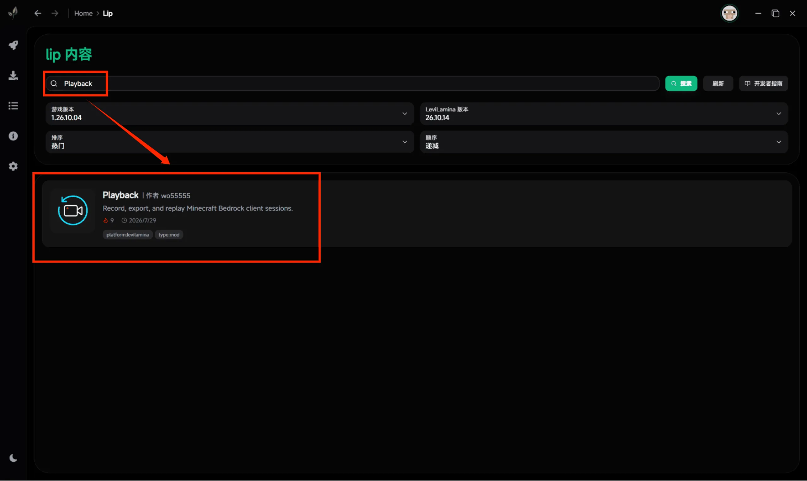
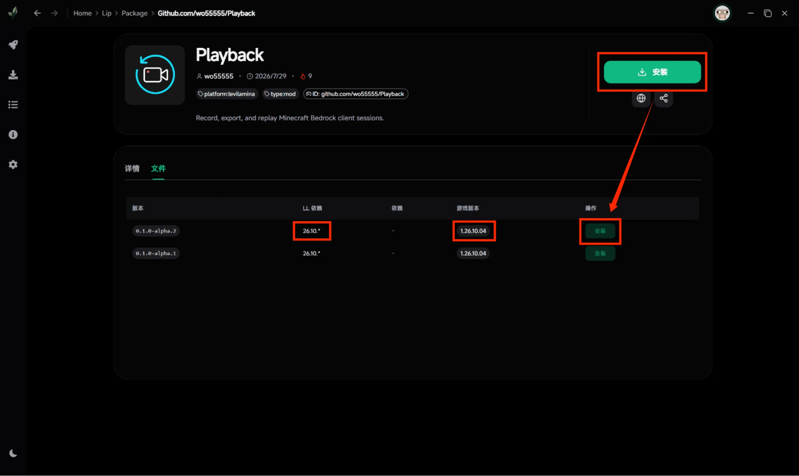

# Playback 安装与使用

[返回主文档](../README_ZH.md) | [English](getting-started.md)

## 安装前须知

Playback 是面向 Windows x64 的 LeviLamina 纯客户端模组。安装时必须选择与实例中的 Minecraft 和 LeviLamina 版本匹配的发行版本。

| Minecraft / LeviLamina | Playback 版本                                                                       |
| ---------------------- | ----------------------------------------------------------------------------------- |
| `26.10.*`              | [`v0.4.2-mc26.10`](https://github.com/wo55555/Playback/releases/tag/v0.4.2-mc26.10) |
| `26.20.*`              | [`v0.4.2-mc26.20`](https://github.com/wo55555/Playback/releases/tag/v0.4.2-mc26.20) |
| `26.40.*`              | [`v0.4.2-mc26.40`](https://github.com/wo55555/Playback/releases/tag/v0.4.2-mc26.40) |
| `26.51.*`              | [`v0.4.2-mc26.50`](https://github.com/wo55555/Playback/releases/tag/v0.4.2-mc26.50) |
| `26.60.*`              | [`v0.4.2-mc26.60`](https://github.com/wo55555/Playback/releases/tag/v0.4.2-mc26.60) |

上表五条发行线均为预发布版本，请仅安装与当前实例匹配的版本。`mc26.50` 对应 Minecraft 26.51；`mc26.60` 构建严格要求 Minecraft `1.26.60.5`。26.40 的依赖范围为 `>=26.40.5 <26.50.0`。

> [!IMPORTANT]
> 建议尽量使用未安装其他第三方模组的独立 LeviLamina 实例。目前暂不保证与其他模组广泛兼容。

> [!WARNING]
> 日常使用建议选择原版标准／精美画质。光线追踪和灵动视效（Vibrant Visuals）已进行针对性的导出测试，但仍属实验性路径。部分导出的规则网格／抖动图案，以及偶发的原生维度加载警告仍在调查中。

> [!CAUTION]
> `v0.4.2` 在各发行线上仍是预发布版本。早于 `v0.4.0` 的录像不再支持，必须重新录制；程序可能无法识别旧归档的不兼容性。相机切换轨道已移除，旧编辑器工程中的切换轨道数据会被丢弃。升级前请备份录像和工程，不提供迁移功能。

## 使用 LeviLauncher 和 Lip 安装

以下截图以 `26.10` 实例为例，仅作安装流程示意，可能展示较早的界面布局。使用 `26.20`、`26.40`、`26.51` 或 `26.60` 时，请选择相互匹配的 Minecraft、LeviLamina 和 Playback 发行线。

1. 在左侧边栏选择 **Download（下载）**，找到需要的 Minecraft 版本，通过安装菜单创建使用 **LeviLamina** 加载器的实例。

<p align="center">
  
</p>

2. 选择 **Instances（实例）**，打开新实例的设置，在**加载器**页面确认已经安装对应版本的 LeviLamina。

<p align="center">
  
</p>

3. 选择 **Launch（启动）**返回主页面，选中目标实例，然后在**内容下载**区域选择 **lip**。

<p align="center">
  
</p>

4. 搜索 **Playback**，然后打开由 `wo55555` 发布的软件包。

<p align="center">
  
</p>

5. 手动选择 **LL 依赖**和**游戏版本**与当前实例一致的发行版本，然后点击该版本所在行的**安装**。Lip 不会根据已安装的 LeviLamina 版本自动选择 Playback 版本。

<p align="center">
  
</p>

安装完成后启动或重启游戏，内置按钮资源包会自动加载，Minecraft 主菜单中应显示 **Playback** 按钮。Release 同时提供 `playback-ui.mcpack` 供单独手动导入。

## 使用 Lip 命令行安装

在目标 LeviLamina 实例的根目录中执行对应命令：

```powershell
# Minecraft / LeviLamina 26.10
lip install github.com/wo55555/Playback@0.4.2-mc26.10#client

# Minecraft / LeviLamina 26.20
lip install github.com/wo55555/Playback@0.4.2-mc26.20#client

# Minecraft / LeviLamina 26.40
lip install github.com/wo55555/Playback@0.4.2-mc26.40#client

# Minecraft / LeviLamina 26.51
lip install github.com/wo55555/Playback@0.4.2-mc26.50#client

# Minecraft 1.26.60.5 / LeviLamina 26.60
lip install github.com/wo55555/Playback@0.4.2-mc26.60#client
```

> [!NOTE]
> 安装客户端变体时必须保留末尾的 `#client`。请始终明确指定并核对匹配的版本；Lip 不会根据已安装的 LeviLamina 版本自动选择。

## 手动安装

从匹配的发行版本下载 `Playback-client-windows-x64.zip`，将压缩包内的 `playback` 目录解压到 LeviLamina 实例的 `mods` 目录，然后重启客户端。

## 录制

进入世界后，打开客户端命令控制台并使用：

```text
record start
record pause
record stop
```

`record start` 开始或继续录制，`record pause` 暂停录制，`record stop` 结束录制并导出回放。暂停菜单的小图标行也提供开始、暂停、结束和取消按钮；从暂停菜单结束录制时会要求输入回放名称。导出的回放归档位于 Playback 的 `data/replays` 目录。

`record indicator` 切换右上角录制指示器的显示状态，`record indicator on|off` 直接设置。`record rate [20-120]` 设置本地玩家视角每秒采样次数，重启游戏前有效；初始值来自配置中的 `record.localPlayerUpdatesPerSecond`。

## 回放

1. 返回主菜单并选择 **Playback**。
2. 在回放浏览器中选择 `.playback` 或兼容的 `.zip` 回放文件。
3. 等待隔离回放世界和初始区块加载完成。
4. 使用时间线播放、暂停、跳转、调整倍速或跳至两端；使用 **File > Exit Replay** 退出回放。

## 相机编辑

1. 在时间线编辑器中添加或选择相机。
2. 将播放头移动到目标 tick，使用**在播放头添加关键帧**。
3. 在属性检查器中编辑位置、偏航、俯仰、滚转、FOV、插值模式和三次贝塞尔控制点。
4. 添加更多关键帧，播放或拖动播放头预览相机运动。暂停时关键帧也会更新预览；在视口上按住鼠标左键可移动自由相机。

每次已录制的维度变化都会自动切断相机插值。不同维度片段中的关键帧不会相互连接，即使中间维度没有相机关键帧也一样。

第一人称与第三人称轨道在首尾关键帧之间观看指定的录制玩家；轨道重叠时，列表中更靠上的轨道优先。视口的对象选择器和右键菜单也可跟随玩家或实体。跟随玩家时按 F5 切换第一／第三人称，单独轻按 Shift 可停止跟随。

## 预览选项

检查器的“预览”页可选择显示聊天、Boss 栏、标题、计分板、动作栏和快捷栏，默认仅开启快捷栏。这些选择同样应用于导出，但导出时的“隐藏 HUD”可隐藏整个 HUD。已录制的容器与服务器表单仅在第一人称跟随录制者时预览。跳转会恢复目标时刻录制的开关状态，切换离开该视角会关闭预览。

预览的“静音”“音量”和“暂停时静音”随编辑器布局保存，不改变导出音频。“暂停时静音”默认开启，抑制暂停或跳转期间触发的世界音效，不会修改录像本身。

## 快捷键

编辑器中的**帮助 > 快捷键**会列出当前绑定。

| 快捷键                          | 功能                  |
| ------------------------------- | --------------------- |
| `Space`                         | 播放 / 暂停           |
| `Home` / `End`                  | 跳至开头 / 结尾       |
| `Left` / `Right`                | 跳转 1 秒             |
| `Ctrl+Left` / `Ctrl+Right`      | 跳转 1 游戏刻         |
| `Up` / `Down`                   | 下一个 / 上一个编辑点 |
| `J` / `L`                       | 减速 / 加速播放       |
| `-` / `=`                       | 缩小 / 放大时间轴     |
| `Alt+滚轮`                      | 以光标为锚缩放时间轴  |
| `\`                             | 缩放时间轴至全长      |
| `K`                             | 添加相机关键帧        |
| `Ctrl+Shift+N`                  | 新建相机轨            |
| `1` / `2` / `3`                 | 切换到相机 1 / 2 / 3  |
| `I` / `O`                       | 标记导出头 / 尾       |
| `Delete` / `Backspace`          | 删除选中项            |
| `Ctrl+Z` / `Ctrl+Y`             | 撤销 / 重做           |
| `Ctrl+S`                        | 保存工程              |
| `Ctrl+E`                        | 打开导出设置          |
| `Ctrl+Shift+F`                  | 最大化 / 还原视口     |
| `Ctrl+Shift+-` / `Ctrl+Shift+=` | 缩小 / 放大界面       |
| `Ctrl+Shift+0`                  | 重置界面缩放          |
| `Esc`（长按 0.8 秒）            | 退出回放并保存        |

编辑器打开时键盘归编辑器所有。在游戏视口上按住鼠标左键可操控观察者相机，按住期间快捷键暂停响应。

## 实验性视频导出

在回放编辑器中打开**文件 > 导出…**。设置分为四页，导出按钮始终可见；窗口较矮时先隐藏摘要，再让设置页滚动：

- **常规**：输出名称和目录、MP4 或 PNG 序列、帧率、起止 tick。名称直接用作文件名，重名时自动加编号。建议通过播放头按钮或时间线 I/O 快捷键设置短区间，以 30 FPS 先试导再导出长片段。
- **视频**：输出分辨率、SSAA、预热帧、“隐藏 HUD”、MP4 编码速度和 CRF。建议从 1x SSAA 开始，切换维度后会重新预热。
- **音频**：开启或关闭游戏音频，选择单声道或立体声，MP4 可选 AAC（默认）、Opus 或 FLAC。AAC 与 Opus 提供 128/192/256/320 kbps，FLAC 为无损编码、不设置码率。PNG 序列启用音频时附带未压缩的 `.audio.wav`。部分播放器不支持 MP4 中的 Opus 或 FLAC，追求兼容性时请选择 AAC。
- **高级**：额外渲染次数（默认 0）。额外渲染会为每个输出帧增加不保存结果的渲染轮次，帮助时间累积效果收敛，但每轮都会增加完整渲染开销。客户端 tick 会自动加速推进，不再提供独立的“加速客户端”开关。

输入的数值立即生效，并限制在允许范围内。开始前请核对摘要。预览音量和静音独立于所有导出音频设置。

实验性导出器根据回放时间逐帧渲染，而不是实时录屏。MP4 使用模组内置的 FFmpeg/libx264；如果 FFmpeg 无法启动，仍可使用 PNG 序列。默认输出目录为 `mods/playback/exports`。

| 渲染后端 | 格式                | SSAA       |
| -------- | ------------------- | ---------- |
| D3D12    | H.264 MP4、PNG 序列 | 1x、2x、4x |
| D3D11    | H.264 MP4、PNG 序列 | 1x         |

> [!IMPORTANT]
> 所有后端的视频导出都仍是实验性功能；上表仅描述采集能力，不是稳定性保证。建议使用原版标准／精美画质，并先导出短片段。相机所在区域必须存在于录像中，无法重建未录制的地形。跨维度加载、回放状态准备、UI 稳定和渲染器预热都有超时限制，录像数据缺失仍可能导致目标场景无法渲染。遇到规则网格／抖动图案或加载警告时请保留日志。

开发说明见[源码构建](building.zh-CN.md)，发行历史见[更新日志](../CHANGELOG.md)。
